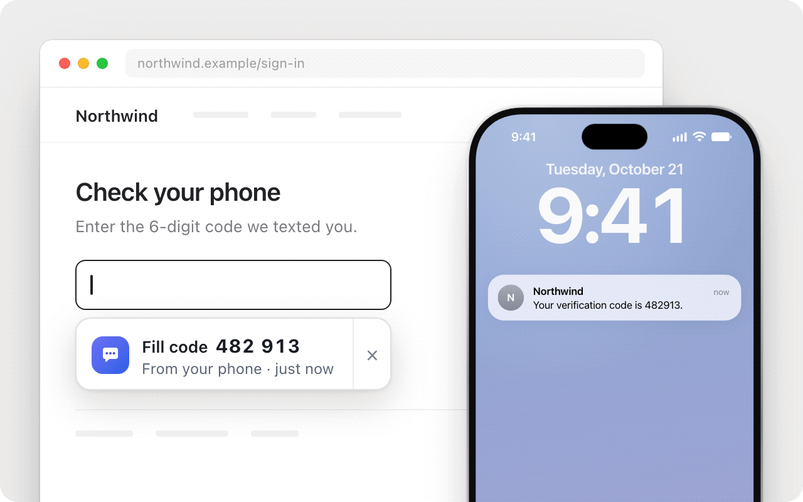
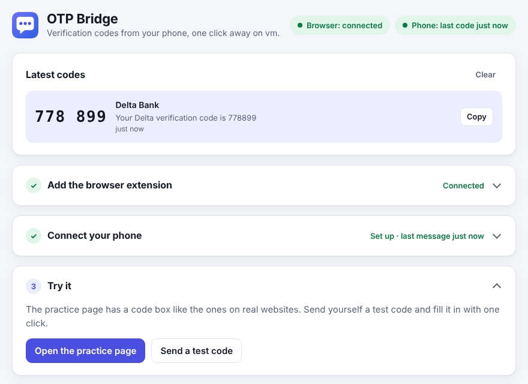

#  OTP Bridge

[](https://github.com/Hadi-Alsinan/otp-bridge/actions/workflows/ci.yml)
[](LICENSE)

A verification code is texted to your phone. A moment later it is waiting under the code box on your
computer, and one click fills it in. It works in Chrome, Edge, Brave and Firefox, on Windows and on
a Mac, with an iPhone or an Android phone.

<picture>
  <source media="(prefers-color-scheme: dark)" srcset="docs/hero/hero-dark.gif">
  
</picture>

It is the "AutoFill from iPhone" that Safari has, rebuilt so that it does not need Safari or a Mac.

Codes that arrive by email in Gmail can be offered the same way. That part needs no phone: one
switch in the extension, turned on once.

## Which phone with which computer

Any phone with any computer. The phone only has to send a small web request to the computer, so the
two never need to be the same brand.

| | Windows PC | Mac | Linux |
| --- | --- | --- | --- |
| **iPhone** | yes | yes | yes |
| **Android phone** | yes | yes | yes |

- An **iPhone** passes the messages on with an automation in its built-in Shortcuts app. Nothing has to be installed on the phone.
- An **Android phone** passes them on with an SMS forwarding app.
- On the computer, the browser can be **Chrome, Edge or Brave**. Firefox works with a limitation described below.

## How it works

```
 phone                         your computer
┌──────────────────┐  Wi-Fi  ┌──────────────────────┐        ┌──────────────────────┐
│ a text arrives   │ ──────► │ OTP Bridge companion │ ─────► │ browser extension    │
│ the phone passes │         │ finds the code and   │        │ shows the code under │
│ it on            │         │ keeps it 10 minutes  │        │ the box, fills it in │
└──────────────────┘         └──────────────────────┘        └──────────────────────┘
```

There are three parts:

1. **The phone** passes matching text messages on. An iPhone does this with an automation in the
   built-in Shortcuts app. An Android phone uses an SMS forwarding app.
2. **The companion** (`companion/`) is a small program on your computer. It receives the message,
   picks out the code, and keeps it in memory for ten minutes. It also serves the setup page.
3. **The browser extension** (`extension/`) notices code boxes on websites, asks the companion
   whether a code has arrived, and offers it.

There is no account and no server in between. The phone talks to the computer directly on your own
network.

Codes from Gmail take a shorter road. While a page shows a code box, the extension asks Gmail for
your unread mail, using the sign-in your browser already has, and hands what is new to the
companion on the same computer. See [Codes from Gmail](#5-codes-from-gmail).

## What you need

- A computer with [Node.js](https://nodejs.org) 18 or newer (install the LTS version).
- Chrome, Edge, Brave or another Chromium browser. Firefox works with a limitation described below.
- An iPhone with the Shortcuts app, or an Android phone.
- The phone and the computer on the same network: the same Wi-Fi, or the computer on the phone's hotspot.

## Set up

It takes about five minutes.

### 1. Start the companion

Get the project first. With Git:

```sh
git clone https://github.com/Hadi-Alsinan/otp-bridge.git
```

Without Git, click the green **Code** button on the
[project page](https://github.com/Hadi-Alsinan/otp-bridge), choose **Download ZIP** and unpack it.

On a Mac, in Terminal:

```sh
cd otp-bridge
node companion/cli.js
```

On Windows, double-click `start-windows.bat`, or in a terminal:

```bat
cd otp-bridge
node companion\cli.js
```

(`otp-bridge` is the folder you downloaded or cloned.)

The dashboard opens in your browser. The first time, the system firewall may ask whether Node.js
may accept connections. Allow it for private networks, otherwise the phone cannot reach the computer.

On a Mac you can also double-click `start-mac.command`. If macOS refuses to open it because it was
downloaded, use the Terminal command above instead.

### 2. Add the browser extension

The dashboard shows these steps with the exact folder to pick.

- **Chrome, Edge, Brave:** open `chrome://extensions` (in Edge `edge://extensions`), switch on
  **Developer mode**, click **Load unpacked** and choose the `extension` folder.
- **Firefox:** open `about:debugging#/runtime/this-firefox`, click **Load Temporary Add-on** and
  choose `extension/manifest.json`. Firefox removes temporary add-ons when it closes, so this has
  to be repeated after every restart of Firefox. If codes do not appear on websites, open
  `about:addons`, OTP Bridge, **Permissions**, and allow access to all websites.

Go back to the dashboard tab. It connects to the extension by itself and shows **Browser: connected**.
Pages that were already open need a reload before codes appear on them.



To use a second browser, click **Copy private link** on the dashboard, open that link in the other
browser, and add the extension there too.

### 3. Connect your phone

Scan the QR code on the dashboard with the phone's camera. The page that opens on the phone confirms
that the phone can reach the computer, shows the address to paste, and lists the steps.

The page picks the address. If the phone can reach the computer by its name, the address ends in
`.local`. That address stays the same on every network, so the phone is set up once. If it cannot,
the page shows the computer's current number, which has to be replaced when the computer joins a
different Wi-Fi.

**iPhone** (Shortcuts app)

1. Tap **Add the shortcut**. It copies the address for you. Choose **Download** and open
   **OTP Bridge** from Safari's downloads.
2. The Shortcuts app asks for the address. Paste and tap **Add Shortcut**.
3. **Automation** tab, **+**, choose **Message**.
4. **Message Contains**: press the space bar once. Choose **Run Immediately**. **Next**.
5. Pick **OTP Bridge** from the list of your shortcuts.

That one automation is enough. A single space makes it run for every text, and the shortcut then
looks at the text on the phone and passes it on only if it has a number in it. A text without a
number never leaves the phone, and the computer keeps a text only if it finds a code in it.

A text with no space in it is not picked up. If your codes arrive like that, as some do in Chinese
or Japanese, add one more automation and type a word those texts use, such as `验证码`, in place of
the space.

If the shortcut cannot be added, the phone page also lists the steps for building the automation
by hand. Built by hand it does not look at the text first, so it uses a word such as `code` in
place of the space, and needs one automation for each word your codes use.

**Android**

1. Install an app that passes incoming SMS on to a web address. The open-source *SMS to URL Forwarder*
   does exactly this; MacroDroid, Tasker and Automate can do it too.
2. Add a rule for every sender (usually `*`), paste the address as the URL, and choose POST.
3. Leave the body as the app suggests. If you write it yourself, send the message text, on its own or
   as JSON such as `{"from":"%from%","text":"%text%"}`. OTP Bridge accepts JSON, form fields and plain text.
4. Let the app read SMS and keep running in the background.

On Android 15 and newer, an app that was not installed from the Play Store is refused the SMS
permission at first. Open **Settings**, **Apps**, the app, tap the three dots, choose
**Allow restricted settings**, then grant the permission again.

The steps on the phone are the same whether the computer is a Windows PC or a Mac.

### 4. Try it

Click **Open the practice page** on the dashboard, then **Send me a test code**. The suggestion
appears under the box. Click it.


### 5. Codes from Gmail

This step is optional, and it does not need the phone.

1. Be signed in to Gmail in the browser that has the extension.
2. Click the OTP Bridge button in the browser toolbar and switch on **Codes from Gmail**.
3. The browser asks whether OTP Bridge may read mail.google.com. Allow it.

From then on, when a website emails you a code, it appears under the code box a few seconds after
the email arrives, marked with who sent it. If several Google accounts are signed in to the
browser, up to four of them are read.

The extension reads what Gmail lists for unread mail in the inbox: the sender, the subject and the
first line or two. So a code is found when it is in the subject or near the top of the email, which
is where most services put it. An email that you have already opened, on the phone for example, is
no longer unread and is not seen.

**It does not work every time.** Gmail lists conversations, not single emails, and it often puts
emails with the same subject from the same sender into one conversation. For a conversation, the
list shows the first lines of the oldest email that is still unread. So when a new code joins a
conversation in which an earlier code was never opened, the list shows the earlier code. The
extension cannot see the new one there. It reads nothing, and the dashboard's activity list says
so. In practice:

- A service that puts the code in the subject (`482913 is your code`) starts a new conversation
  every time, and its codes are found.
- A service that sends every code under the same subject (`Your sign-in code`) works when Gmail
  starts a new conversation for the email, or when the earlier emails of the conversation have been
  opened. Otherwise the code has to be read from the email.
- The page with the code box has to be open and in front before the email arrives. The extension
  compares Gmail's list before and after, and does not trust an email that was already there.

**It can offer an older code, in two cases.** Gmail's list gives no way to tell them from a new
code:

- An earlier email of the same conversation was archived, or moved out of the inbox in another
  way, without being opened. Gmail then lists the new email as a new conversation and still shows
  the earlier email's first lines. OTP Bridge offers the earlier code, unless that earlier email
  is among the last 2,000 it has seen in Gmail's list.
- Two emails of the same conversation arrive within a few seconds of each other. The first one's
  code is offered, and the second is not seen.

If a website refuses a code that came from Gmail, read the code from the email.

### 6. Let it start by itself

On the dashboard, switch on **Start OTP Bridge when I log in**. From then on it runs quietly in the
background and you do not need the terminal window.

## Using it

When a code arrives and the page you are on has a code box, the suggestion appears under the box.
Click it, or press the down arrow and then Enter. Codes are offered for three minutes. If you start
typing the code yourself, the suggestion steps aside.

If a website's code box is not recognised:

- click the OTP Bridge button in the browser toolbar and choose **Fill** or **Copy**, or
- right-click the box and choose **Fill in the code from my phone**.

For apps outside the browser, switch on **Also copy each new code to the clipboard** on the
dashboard and paste the code.

## Commands

Run them as `node companion/cli.js <command>` from the `otp-bridge` folder.

| Command | What it does |
| --- | --- |
| `start` | Runs the companion. This is the default. `--no-open` skips opening the dashboard. |
| `open` | Opens the dashboard in your browser. |
| `status` | Says whether it is running, and what is connected. |
| `qr` | Shows the phone pairing code in the terminal. |
| `test [message]` | Sends a test message, as if it came from the phone. |
| `stop` | Stops the copy running in the background. |
| `autostart on`, `off`, `status` | Start at login. On Windows, `autostart on --visible` uses a minimised window instead of a hidden one. |
| `reset-phone` | Makes a new phone address. The old one stops working. |

`--port <number>` changes the port (default 4812). The port is part of the phone's address, so the
phone has to be updated after changing it.

## Privacy and security

- **Where codes live.** In the companion's memory, for ten minutes. They are never written to disk
  and never sent anywhere except to your own browser. Messages without a code are dropped on arrival.
- **Who can read them.** Only this computer. The dashboard and the extension's connection need a
  random token that is created on first run and stored in your settings folder. Other devices on
  the network can only reach the phone address, and only to drop a message in.
- **The phone address is a secret.** Anyone on your network who knows it can send fake messages to
  your computer. They cannot read anything. If it leaks, click **Reset** on the dashboard.
- **What is read in Gmail.** Nothing, unless you switch on **Codes from Gmail**. Then the extension
  asks Gmail for the list of your unread mail while a page shows a code box, and once when you open
  its window from the toolbar: sender, subject and the first line or two of each. An email that arrives while it watches, and has a digit in it, is
  handed to the companion on this computer, which keeps it only if it finds a code. Of an email it
  cannot read a code from safely, only the sender's name goes to the companion, for the activity
  list. Nothing else is read, nothing is marked as read, and no password is stored: the browser's
  own sign-in is used. The extension remembers which entries it has seen, as numbers and not as
  text. Turning the switch off hands the access back.
- **What the phone sends.** An iPhone passes on every text that has a number in it, not only the
  ones with codes; a text without a number stays on the phone. An Android forwarding app passes on
  whatever its rule says, usually every SMS.
- **The phone talks to the computer in plain HTTP.** Someone who can listen in on your network
  could see a text as it passes. Use this on networks you trust: at home, or on your own hotspot.
- **What a website can see.** Nothing until you click. The suggestion is drawn in a way page scripts
  cannot read, it ignores clicks made by scripts, and it does not react to anything a page puts in
  its own code box, so a page cannot find the code by guessing. When a message names the website its
  code is for (`@example.com #123456`), the code is only offered on that website.
- **What is still possible.** Like every autofill that draws inside a web page, a malicious page
  could in theory cover the suggestion with something else and trick you into clicking it. It would
  need to be the page you are looking at within three minutes of a code arriving.
- **The extension runs on every page**, as a password manager does, because code boxes can be
  anywhere. It reads the names and labels of input fields to recognise code boxes. It sends nothing
  about the pages you visit anywhere.

Settings folder: `~/Library/Application Support/otp-bridge` on a Mac, `%APPDATA%\otp-bridge` on
Windows, `~/.config/otp-bridge` on Linux.

## Limits

- The phone and the computer must be on the same network when the text arrives. Away from it, the
  phone's automation fails quietly and nothing reaches the computer.
- The address with the computer's name (ending in `.local`) keeps working when the computer changes
  Wi-Fi. Not every network or phone can use it, so the phone page only chooses it after the phone
  has reached the computer by it. A phone set up with the computer's number keeps sending to the old
  number after a change of Wi-Fi. The dashboard says which of the two the phone uses, and the
  dashboard and the toolbar popup warn when the number has changed.
- An iPhone does not pick up a text that has no space in it, such as a text that is only the code.
  An automation built by hand only forwards messages that contain the words you set up.
- Codes from Gmail are read from the short preview Gmail gives of each unread conversation. A code
  further down a long email is not found, and neither is one in mail that skips the inbox. A new
  email in a conversation that has an older unread email in it is not read either; see
  [Codes from Gmail](#5-codes-from-gmail). It works in
  Chrome, Edge, Brave and other Chromium browsers; it has not been tried in Firefox.
- Not every website's code box is recognised. The toolbar button and the right-click menu cover those.
- In Firefox the extension has to be loaded again after each restart. There is no Safari version;
  Safari on a Mac already does this with an iPhone.

### What has been tested

Most of this was developed and tested on Linux, with later work on a Mac. Be prepared for rough
edges in the parts that could not be run. The workflow in `.github/workflows/ci.yml` runs the unit
tests, the browser tests and the launch scripts on real Windows, macOS and Linux machines for every
push and pull request; the badge at the top of this page shows the latest result.

| Part | How it was checked |
| --- | --- |
| Finding the code in a message | 192 sample messages in English, Arabic and 19 other languages; 39 of them are messages that must be ignored |
| The companion | Automated tests of every route, including the security rules, with Node.js 22. One test in a real browser checks that a long message stays inside its card on the dashboard |
| The extension in Chromium | 37 tests in a real browser: plain fields, split boxes, real React forms, a bank page in a frame, pop-up dialogs, right-to-left pages, pages that must be left alone, and pages that try to read or guess the code |
| Codes from Gmail | Automated tests with a stand-in for Gmail, one of them in a real browser: the switch, an email arriving, the code offered and filled in. It has been used with one real Gmail account, in Arc, and how Gmail lists conversations was measured there with test emails. The rule that compares Gmail's count before and after an email arrives was run there as well: a code in a conversation of its own was offered 5 seconds after the email arrived, and a second code that joined that conversation while the first was unread was left alone. With the first email archived unread, Gmail listed the second as a new conversation under the first one's words; that is the first case under "It can offer an older code" |
| Firefox | Not run. The extension is written to the cross-browser rules but has not been loaded in Firefox |
| Windows and macOS | The launch scripts and start at login run on Windows and macOS build machines. The companion has been used on one Mac. It has not been used on a real Windows PC |
| Android | Not run on a phone. The steps follow published guides for the forwarding apps; the companion is tested with the requests these send (JSON, form fields, plain text) |
| The iPhone shortcut | Built and signed on a Mac with Apple's tool; tests check what it contains and that the companion serves it. An earlier version, without the check on the phone, was added and used on one iPhone. The current version, with the check and the single automation, has not been tried on a phone |

## If something does not work

**The phone cannot open the address.** Check that both are on the same Wi-Fi and not on a guest
network. On Windows, allow Node.js through the firewall for the kind of network you are on. Turn
off any VPN on the phone or the computer and try again.

**It worked and then stopped.** The computer probably has a new address. Look at the dashboard: it
says so when it sees this. Scan the QR code again with the phone and follow **Change the address**
on the page that opens. If that page shows an address ending in `.local`, it will not change again.

**The code arrives on the dashboard but not on the website.** Check that the dashboard says
*Browser: connected*, and reload the website's tab. If the box is still not recognised, use the
toolbar button.

**Nothing arrives at all.** Look at *Activity* on the dashboard. If it shows no message, the phone
did not send one: on an iPhone the text may have no space or no number in it, or, in an automation
built by hand, not contain the word you typed. If it shows a
message without a code, paste the text into *Check a message* to see what was found. If it says the
phone sent an empty message, the automation is not passing the text on: open it and set the
shortcut's input to **Shortcut Input**.

**A code from Gmail does not show up.** Click the OTP Bridge button in the toolbar. Under **Codes
from Gmail** it says which account is read, or that the browser is not signed in to Gmail. If the
account is right, look at **Activity** on the dashboard. If it says the email joined a conversation
that has an older unread email in it, that it was already in Gmail before OTP Bridge began
watching, or that Gmail now shows other first lines for a conversation, the code has to be read
from the email. Otherwise look at the email: the code has to be in the subject or the first line or
two, and the email has to be unread and in the inbox.

**Start at login does nothing on Windows.** Run `node companion\cli.js autostart on --visible`.

**macOS lists "node" under Login Items.** That is OTP Bridge. Leave it allowed.

## Updating and removing

To update, replace the folder with the new version, run `node companion/cli.js stop`, start it
again, and click the reload button for OTP Bridge on the browser's extensions page. If start at
login is on, switch it off and on again so the background copy is replaced.

To remove it, switch off start at login, run `node companion/cli.js stop`, remove the extension
from the browser, delete the automation and the shortcut on the phone, and delete the settings folder.

## For developers

```
companion/cli.js          entry point
companion/lib/            server, code parser, in-memory store, settings, start at login
companion/web/            dashboard, phone setup page, practice page
extension/                the browser extension (Manifest V3, no build step)
scripts/                  builds the icons and the iPhone shortcut
test/                     unit tests
e2e/                      browser tests with Playwright
```

The companion and the extension have no runtime dependencies.

```sh
npm test            # unit tests, no install needed
npm install         # only for the browser tests
npx playwright install chromium
npm run test:e2e
npm run shortcut    # rebuild and sign the iPhone shortcut (needs a Mac signed in to iCloud)
```

## Contributing

Help is welcome. The most useful thing is a text message whose code was not recognised: every one
becomes a test. Reports from phones, browsers and computers that have not been tried yet come
next. [CONTRIBUTING.md](CONTRIBUTING.md) explains how to get the project running and what a change
needs.

To report a security problem, see [SECURITY.md](SECURITY.md). Please do not open a public issue
for it.

## Licence

[MIT](LICENSE)
