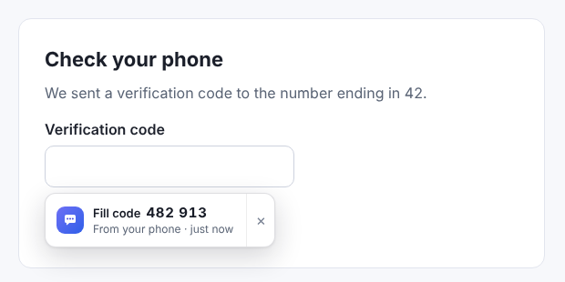

# OTP Bridge

A verification code is texted to your phone. A moment later it is waiting under the code box on your
computer, and one click fills it in. It works in Chrome, Edge, Brave and Firefox, on Windows and on
a Mac, with an iPhone or an Android phone.



It is the "AutoFill from iPhone" that Safari has, rebuilt so that it does not need Safari or a Mac.

## Which phone with which computer

Any phone with any computer. The phone only has to send a small web request to the computer, so the
two never need to be the same brand.

| | Windows PC | Mac | Linux |
| --- | --- | --- | --- |
| **iPhone** | yes | yes | yes |
| **Android phone** | yes | yes | yes |

- An **iPhone** passes the messages on with an automation in its built-in Shortcuts app. Nothing has to be installed on the phone.
- An **Android phone** passes them on with an SMS forwarding app.
- On the computer, the browser can be **Chrome, Edge or Brave**. Firefox works with a limitation described below.

## How it works

```
 phone                         your computer
┌──────────────────┐  Wi-Fi  ┌──────────────────────┐        ┌──────────────────────┐
│ a text arrives   │ ──────► │ OTP Bridge companion │ ─────► │ browser extension    │
│ the phone passes │         │ finds the code and   │        │ shows the code under │
│ it on            │         │ keeps it 10 minutes  │        │ the box, fills it in │
└──────────────────┘         └──────────────────────┘        └──────────────────────┘
```

There are three parts:

1. **The phone** passes matching text messages on. An iPhone does this with an automation in the
   built-in Shortcuts app. An Android phone uses an SMS forwarding app.
2. **The companion** (`companion/`) is a small program on your computer. It receives the message,
   picks out the code, and keeps it in memory for ten minutes. It also serves the setup page.
3. **The browser extension** (`extension/`) notices code boxes on websites, asks the companion
   whether a code has arrived, and offers it.

Nothing goes over the internet and there is no account. The phone talks to the computer directly
on your own network.

## What you need

- A computer with [Node.js](https://nodejs.org) 18 or newer (install the LTS version).
- Chrome, Edge, Brave or another Chromium browser. Firefox works with a limitation described below.
- An iPhone with the Shortcuts app, or an Android phone.
- The phone and the computer on the same network: the same Wi-Fi, or the computer on the phone's hotspot.

## Set up

It takes about five minutes.

### 1. Start the companion

On a Mac, in Terminal:

```sh
cd otp-bridge
node companion/cli.js
```

On Windows, double-click `start-windows.bat`, or in a terminal:

```bat
cd otp-bridge
node companion\cli.js
```

(`otp-bridge` is the folder you downloaded or cloned.)

The dashboard opens in your browser. The first time, the system firewall may ask whether Node.js
may accept connections. Allow it for private networks, otherwise the phone cannot reach the computer.

On a Mac you can also double-click `start-mac.command`. If macOS refuses to open it because it was
downloaded, use the Terminal command above instead.

### 2. Add the browser extension

The dashboard shows these steps with the exact folder to pick.

- **Chrome, Edge, Brave:** open `chrome://extensions` (in Edge `edge://extensions`), switch on
  **Developer mode**, click **Load unpacked** and choose the `extension` folder.
- **Firefox:** open `about:debugging#/runtime/this-firefox`, click **Load Temporary Add-on** and
  choose `extension/manifest.json`. Firefox removes temporary add-ons when it closes, so this has
  to be repeated after every restart of Firefox. If codes do not appear on websites, open
  `about:addons`, OTP Bridge, **Permissions**, and allow access to all websites.

Go back to the dashboard tab. It connects to the extension by itself and shows **Browser: connected**.
Pages that were already open need a reload before codes appear on them.


To use a second browser, click **Copy private link** on the dashboard, open that link in the other
browser, and add the extension there too.

### 3. Connect your phone

Scan the QR code on the dashboard with the phone's camera. The page that opens on the phone confirms
that the phone can reach the computer, shows the address to paste, and lists the steps:

**iPhone** (Shortcuts app)

1. **Automation** tab, **+**, choose **Message**.
2. **Message Contains**: type `code`. Choose **Run Immediately**. **Next**.
3. **New Blank Automation**, add the action **Get Contents of URL**, and paste the address.
4. Open the action's options: **Method** = **POST**, **Request Body** = **JSON**.
5. **Add new field**, **Text**, key `message`, value **Shortcut Input**. **Done**.

The automation only runs for messages that contain the word you typed. Make one more for each
word your codes use, for example `OTP`, `verification`, `passcode` or `رمز`.

**Android**

1. Install an app that passes incoming SMS on to a web address. The open-source *SMS to URL Forwarder*
   does exactly this; MacroDroid, Tasker and Automate can do it too.
2. Add a rule for every sender (usually `*`), paste the address as the URL, and choose POST.
3. Leave the body as the app suggests. If you write it yourself, send the message text, on its own or
   as JSON such as `{"from":"%from%","text":"%text%"}`. OTP Bridge accepts JSON, form fields and plain text.
4. Let the app read SMS and keep running in the background.

On Android 15 and newer, an app that was not installed from the Play Store is refused the SMS
permission at first. Open **Settings**, **Apps**, the app, tap the three dots, choose
**Allow restricted settings**, then grant the permission again.

The steps on the phone are the same whether the computer is a Windows PC or a Mac.

### 4. Try it

Click **Open the practice page** on the dashboard, then **Send me a test code**. The suggestion
appears under the box. Click it.

### 5. Let it start by itself

On the dashboard, switch on **Start OTP Bridge when I log in**. From then on it runs quietly in the
background and you do not need the terminal window.

## Using it

When a code arrives and the page you are on has a code box, the suggestion appears under the box.
Click it, or press the down arrow and then Enter. Codes are offered for three minutes.

If a website's code box is not recognised:

- click the OTP Bridge button in the browser toolbar and choose **Fill** or **Copy**, or
- right-click the box and choose **Fill in the code from my phone**.

For apps outside the browser, switch on **Also copy each new code to the clipboard** on the
dashboard and paste the code.

## Commands

Run them as `node companion/cli.js <command>` from the `otp-bridge` folder.

| Command | What it does |
| --- | --- |
| `start` | Runs the companion. This is the default. `--no-open` skips opening the dashboard. |
| `open` | Opens the dashboard in your browser. |
| `status` | Says whether it is running, and what is connected. |
| `qr` | Shows the phone pairing code in the terminal. |
| `test [message]` | Sends a test message, as if it came from the phone. |
| `stop` | Stops the copy running in the background. |
| `autostart on`, `off`, `status` | Start at login. On Windows, `autostart on --visible` uses a minimised window instead of a hidden one. |
| `reset-phone` | Makes a new phone address. The old one stops working. |

`--port <number>` changes the port (default 4812). The port is part of the phone's address, so the
phone has to be updated after changing it.

## Privacy and security

- **Where codes live.** In the companion's memory, for ten minutes. They are never written to disk
  and never sent anywhere except to your own browser. Messages without a code are dropped on arrival.
- **Who can read them.** Only this computer. The dashboard and the extension's connection need a
  random token that is created on first run and stored in your settings folder. Other devices on
  the network can only reach the phone address, and only to drop a message in.
- **The phone address is a secret.** Anyone on your network who knows it can send fake messages to
  your computer. They cannot read anything. If it leaks, click **Reset** on the dashboard.
- **The phone talks to the computer in plain HTTP.** Someone who can listen in on your network
  could see a code as it passes. Use this on networks you trust: at home, or on your own hotspot.
- **What a website can see.** Nothing until you click. The suggestion is drawn in a way page scripts
  cannot read, and it ignores clicks made by scripts. When a message names the website its code is
  for (`@example.com #123456`), the code is only offered on that website.
- **What is still possible.** Like every autofill that draws inside a web page, a malicious page
  could in theory cover the suggestion with something else and trick you into clicking it. It would
  need to be the page you are looking at within three minutes of a code arriving.
- **The extension runs on every page**, as a password manager does, because code boxes can be
  anywhere. It reads the names and labels of input fields to recognise code boxes. It sends nothing
  about the pages you visit anywhere.

Settings folder: `~/Library/Application Support/otp-bridge` on a Mac, `%APPDATA%\otp-bridge` on
Windows, `~/.config/otp-bridge` on Linux.

## Limits

- The phone and the computer must be on the same network when the text arrives. Away from it, the
  phone's automation fails quietly and nothing reaches the computer.
- If the router gives the computer a new address, the phone keeps sending to the old one. The
  dashboard and the toolbar popup warn about this. Scanning the QR code again fixes it. The phone
  page offers an address based on the computer's name where the network supports it, and that one
  keeps working.
- An iPhone only forwards messages that contain the words you set up.
- Not every website's code box is recognised. The toolbar button and the right-click menu cover those.
- In Firefox the extension has to be loaded again after each restart. There is no Safari version;
  Safari on a Mac already does this with an iPhone.

### What has been tested

Everything was developed and tested on Linux. Be prepared for rough edges in the parts that could
not be run there.

| Part | How it was checked |
| --- | --- |
| Finding the code in a message | 189 sample messages in English, Arabic and 19 other languages; 36 of them are messages that must be ignored |
| The companion | Automated tests of every route, including the security rules, with Node.js 22 |
| The extension in Chromium | 35 tests in a real browser: plain fields, split boxes, real React forms, a bank page in a frame, pop-up dialogs, right-to-left pages, pages that must be left alone |
| Firefox | Not run. The extension is written to the cross-browser rules but has not been loaded in Firefox |
| Windows and macOS | Not run. The start-at-login files and launch scripts are checked for correct content by tests, but have never been executed on a real PC or Mac |
| iPhone and Android | Not run on a phone. The phone steps follow published guides for the Shortcuts automation and the forwarding apps; the companion is tested with the requests these send (JSON, form fields, plain text) |

## If something does not work

**The phone cannot open the address.** Check that both are on the same Wi-Fi and not on a guest
network. On Windows, allow Node.js through the firewall for the kind of network you are on. Turn
off any VPN on the phone or the computer and try again.

**It worked and then stopped.** The computer probably has a new address. Look at the dashboard: it
says so when it sees this. Scan the QR code again and paste the new address into the automation.

**The code arrives on the dashboard but not on the website.** Check that the dashboard says
*Browser: connected*, and reload the website's tab. If the box is still not recognised, use the
toolbar button.

**Nothing arrives at all.** Look at *Activity* on the dashboard. If it shows no message, the phone
did not send one: on an iPhone the text may not contain the word in your automation. If it shows a
message without a code, paste the text into *Check a message* to see what was found.

**Start at login does nothing on Windows.** Run `node companion\cli.js autostart on --visible`.

**macOS lists "node" under Login Items.** That is OTP Bridge. Leave it allowed.

## Updating and removing

To update, replace the folder with the new version, run `node companion/cli.js stop`, start it
again, and click the reload button for OTP Bridge on the browser's extensions page. If start at
login is on, switch it off and on again so the background copy is replaced.

To remove it, switch off start at login, run `node companion/cli.js stop`, remove the extension
from the browser, delete the automation on the phone, and delete the settings folder.

## For developers

```
companion/cli.js          entry point
companion/lib/            server, code parser, in-memory store, settings, start at login
companion/web/            dashboard, phone setup page, practice page
extension/                the browser extension (Manifest V3, no build step)
test/                     unit tests
e2e/                      browser tests with Playwright
```

The companion and the extension have no runtime dependencies.

```sh
npm test            # unit tests, no install needed
npm install         # only for the browser tests
npx playwright install chromium
npm run test:e2e
```
